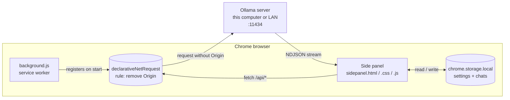
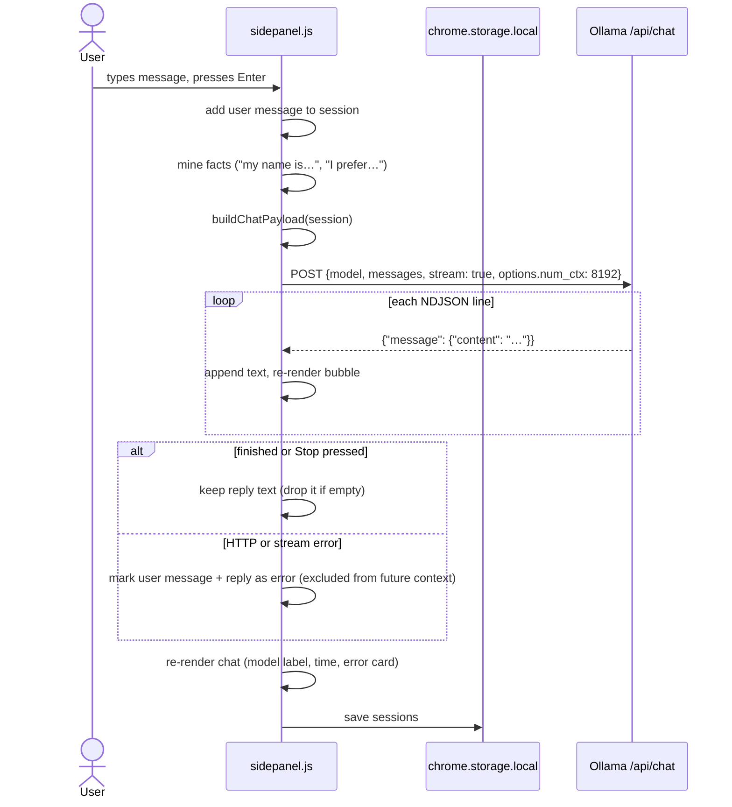
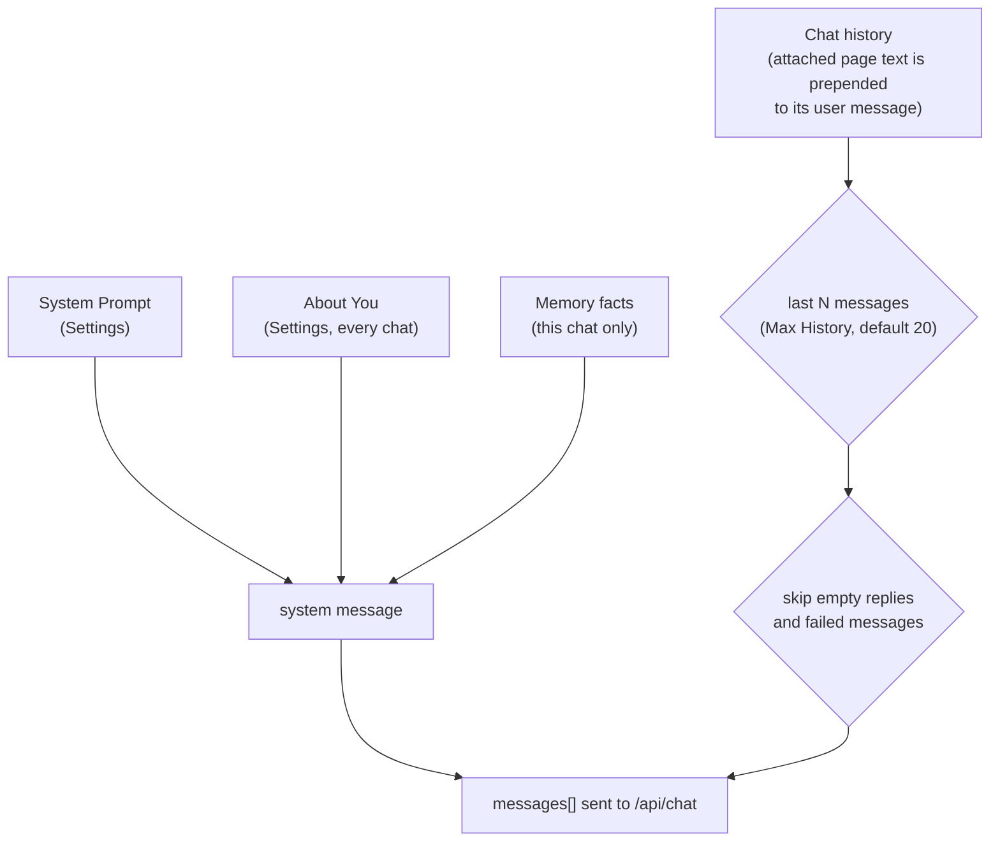
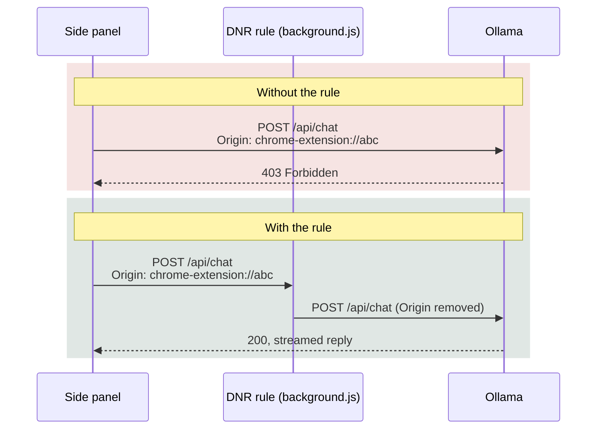
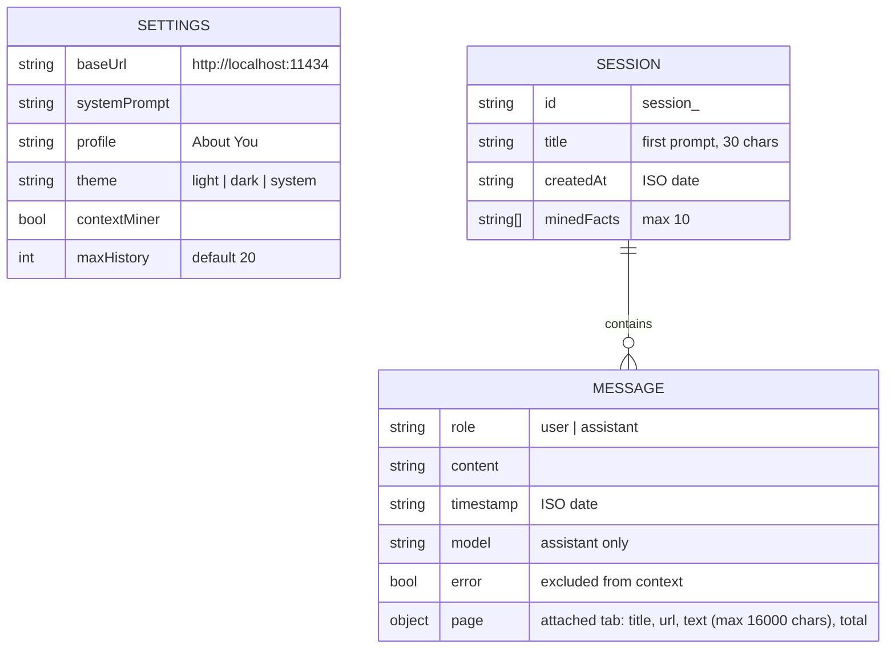
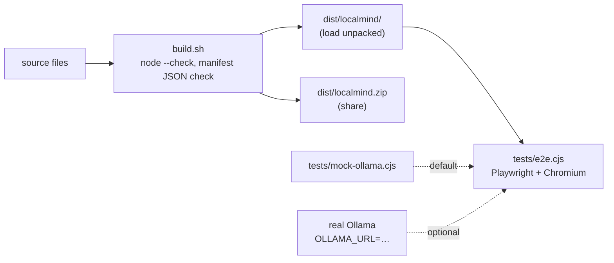

# Architecture

LocalMind is a Manifest V3 Chrome extension with no build step and no runtime dependencies. It is plain HTML, CSS and JavaScript that talks directly to an [Ollama](https://ollama.com) server over HTTP.

- [Components](#components)
- [Files](#files)
- [Sending a message](#sending-a-message)
- [What the model receives](#what-the-model-receives)
- [Why the Origin header is removed](#why-the-origin-header-is-removed)
- [Stored data](#stored-data)
- [Ollama API used](#ollama-api-used)
- [Build and test](#build-and-test)

## Components

- **Service worker** (`background.js`) opens the side panel when you click the toolbar icon and registers one network rule that strips the `Origin` header from the extension's own requests.
- **Side panel** (`sidepanel.js`) holds all app logic: settings, chat sessions, prompt assembly, streaming, the model manager, search and export.
- **Storage** is `chrome.storage.local`. Nothing is synced or sent anywhere except the Ollama server you configure.

## Files

| File | Responsibility |
|---|---|
| `manifest.json` | Permissions (`sidePanel`, `storage`, `declarativeNetRequestWithHostAccess`, `scripting` for reading the active tab's text, `contextMenus` for the right-click menu), host access (`http://*/*`, `https://*/*`) so any server address works, side panel and icon registration. |
| `background.js` | Side panel open-on-click behaviour; the **Ask LocalMind** right-click menu, which opens the panel and queues the selection in `chrome.storage.session` (`pendingAsk`) for the panel to send; the dynamic rule that removes `Origin` (see [below](#why-the-origin-header-is-removed)). |
| `sidepanel.html` | Markup: header, model bar, history drawer with search, messages, input, Settings and Context Inspector dialogs. |
| `sidepanel.css` | Design tokens on `:root` (light) and `:root[data-theme="dark"]`, then component styles. All colours come from tokens. |
| `sidepanel.js` | State, storage, Ollama client, NDJSON reader, prompt builder, memory miner, rendering, model manager, theme, export. |
| `build.sh` | Syntax-checks the JS, validates the manifest, writes `dist/localmind/` and `dist/localmind.zip`. |
| `tests/e2e.cjs` | Playwright test that loads `dist/localmind` and drives the real UI. |
| `tests/mock-ollama.cjs` | Small fake Ollama API so tests run without a model. |

## Sending a message

Stop uses an `AbortController`. Lines of the stream can arrive split across network chunks, so `readNdjson()` keeps the incomplete tail in a buffer until the next chunk arrives. Chat streaming and model downloads share that reader.

## What the model receives

Every request is rebuilt from stored state by `buildChatPayload()`:

The token counter under the input box is computed from this same payload, at roughly 4 characters per token, so it shows what the next request will actually cost.

## Why the Origin header is removed

Chrome attaches `Origin: chrome-extension://<id>` to an extension's POST and DELETE requests. Ollama rejects unknown origins with **403** unless the server sets `OLLAMA_ORIGINS`. GET requests carry no Origin, which is why the model list loads but chat fails.

The rule only matches requests whose initiator is this extension (`initiatorDomains: [chrome.runtime.id]`), so it never touches normal browsing. Users can still set `OLLAMA_ORIGINS="chrome-extension://*"` on the server instead.

## Stored data

All keys live in `chrome.storage.local`, which Chrome scopes to the extension's ID. For an unpacked extension, the ID depends on the folder it was loaded from.

| Key | Value |
|---|---|
| `localmind_settings` | `SETTINGS` object |
| `localmind_sessions` | array of `SESSION`, newest first |
| `localmind_current_session_id` | id of the open chat |

## Ollama API used

| Endpoint | Used for |
|---|---|
| `GET /api/tags` | Model dropdown, model list in Settings, connection status |
| `POST /api/chat` | Chat replies, streamed as NDJSON |
| `POST /api/pull` | Download a model, streamed progress (`status`, `completed`, `total`) |
| `DELETE /api/delete` | Remove a model from the server (asks for confirmation first) |

## Build and test

The mock server returns 403 for any request that has an `Origin` header, just like Ollama. A passing chat test therefore also proves the Origin rule works. CI runs the same test against the mock on every push and pull request.
